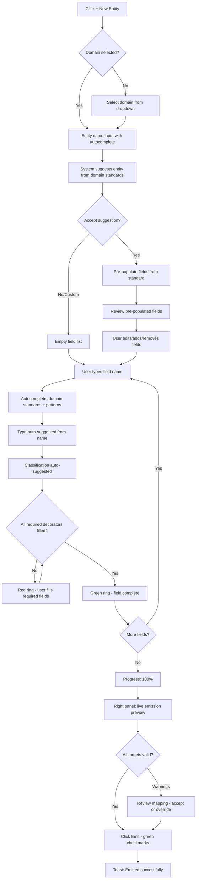
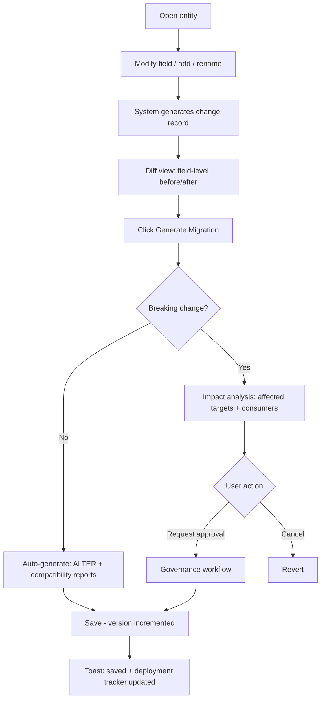
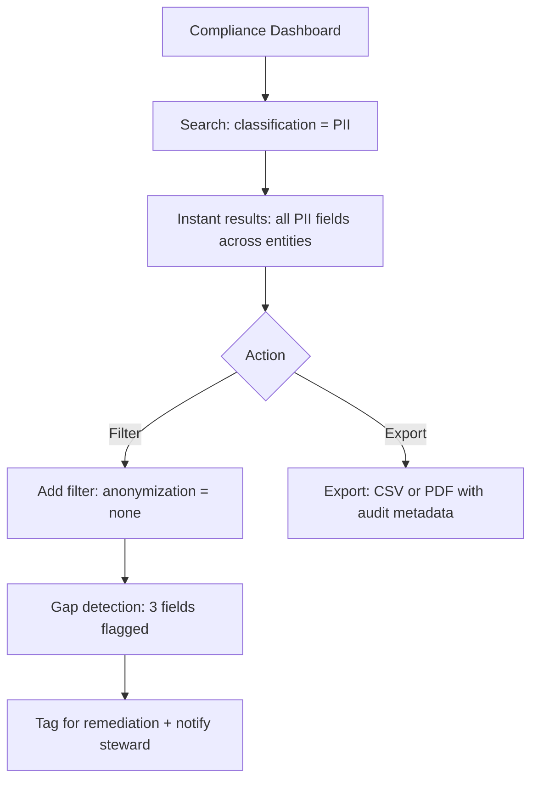
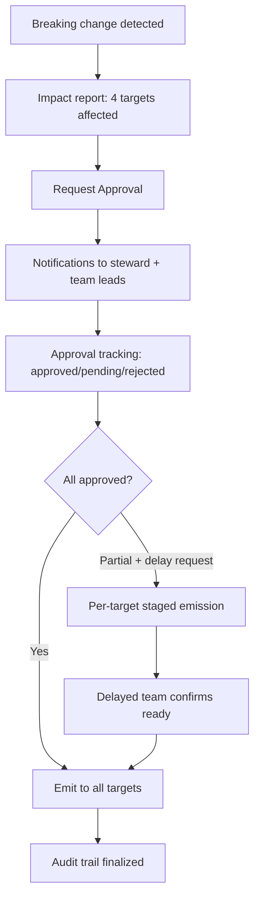
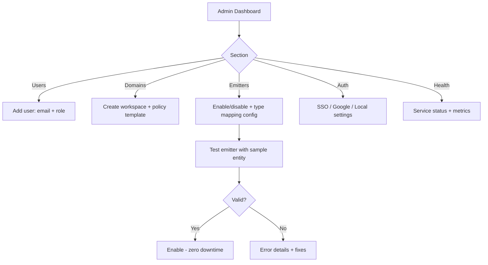
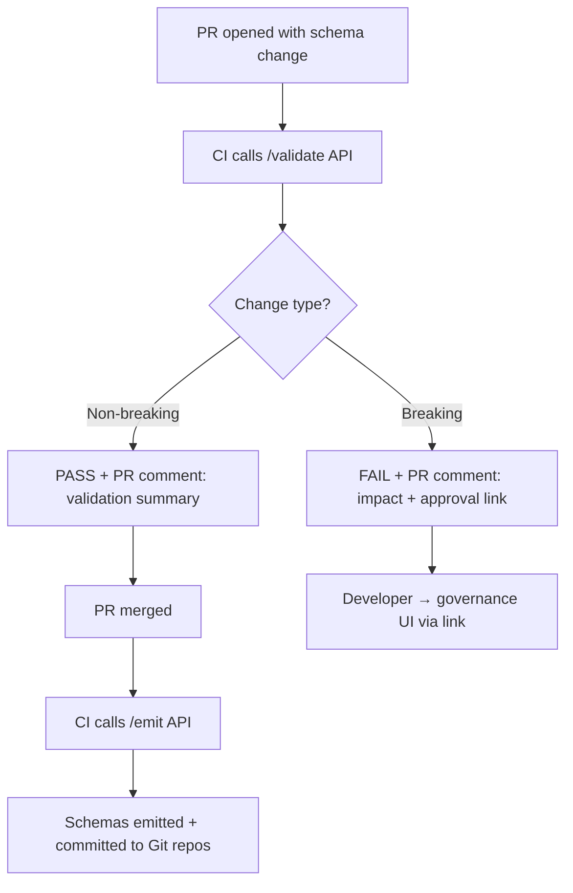

# UX Design Specification - Super Schema

**Author:** Jay
**Date:** 2026-04-01

---

## Executive Summary

### Project Vision

Super Schema is a **data IDE for logical schemas** — a visual, interactive workspace where data modelers define entities once and the system handles all downstream translation. The UX must bridge two worlds: the **conceptual simplicity** of "fill out a form describing your data" with the **technical depth** of TypeSpec's type system (models, scalars, enums, unions, templates, decorators). Users never see TypeSpec — the UI must capture everything TypeSpec can express through visual controls, autocomplete, and intelligent defaults.

**Design theme:** Inspired by Hex's refined minimalism — dark-mode-forward with frosted glass panels, subtle gradient borders, inset shadows for depth, monospace typography for data/code elements, and warm accent colors that avoid corporate sterility. The aesthetic is "professional data tool with personality" — closer to a modern code editor than a JIRA-style enterprise app.

### Target Users

| Persona | UX Skill Level | Primary Interaction Mode | Design Implication |
|---------|---------------|-------------------------|-------------------|
| **Data Engineer (Priya)** | High technical, medium UX | Schema creation, emission, change management | Power-user shortcuts, keyboard navigation, side-by-side code preview |
| **CDO / Governance (Raj)** | Low technical, high executive | Compliance queries, reports, audit review | Dashboard-first, filter-heavy, export-oriented |
| **ML Engineer (Maya)** | High technical, low schema expertise | Occasional schema edits, governance workflows | Clear guidance, impact analysis visualization, approval tracking |
| **Platform Admin (Alex)** | High DevOps, medium UX | Configuration, monitoring, user management | Admin panel, system health dashboards, emitter management |
| **API/CI/CD Consumer** | Programmatic only | API calls, no UI interaction | API docs, not UI design |

### Key Design Challenges

1. **The 8-decorator complexity problem.** Each field has metadata across 8 categories (structure, semantics, classification, policy, quality, lineage, operational hints, evolution). Showing all 8 simultaneously creates overwhelming forms. The UX must surface the right decorators at the right time — progressive disclosure, smart defaults, and contextual grouping.

2. **Multi-target emission preview.** Users need to see emitted output for 3-15+ targets side by side. This is a panel management problem — tabbed views, resizable panels, diff overlays, syntax highlighting for 6+ languages (SQL, JSON, YAML, Protobuf, TypeScript, Java). Must feel like a code editor, not a report viewer.

3. **Type system depth without TypeSpec exposure.** TypeSpec supports models, scalars, enums, unions, templates, intersections, and aliases. The UI must let users express all of these visually — nested entity builders, enum editors, union type constructors, template instantiation — without ever mentioning TypeSpec syntax.

4. **Governance workflow without friction.** Breaking changes trigger multi-stakeholder approval flows. The UX must make approvals fast and clear — notification center, one-click approve/reject, impact visualization, per-target staging controls. It cannot become a bottleneck.

5. **Autocomplete and suggestions everywhere.** Every input should offer intelligent suggestions: field names from domain standards (schema.org, HL7/FHIR), type recommendations based on field name patterns, classification suggestions based on field semantics, quality rule templates based on type. The system should feel like it already knows what you're trying to define.

### Design Opportunities

1. **"Figma for data schemas" experience.** No competitor has a visual schema editor. The editor should feel as fluid as dragging components in a design tool — instant feedback, live preview, undo/redo, and the satisfaction of seeing correct emitted output appear in real-time.

2. **Hex-inspired dark theme as brand identity.** A sophisticated dark theme with Hex-style frosted glass panels, subtle gradients, and warm accent colors would immediately differentiate Super Schema from every existing data tool. The aesthetic itself signals "this is a new kind of tool."

3. **Intelligent onboarding through domain standards.** When a user creates a "Customer" entity, the system can suggest fields from schema.org's Person/Customer schema, pre-filled with sensible types, classifications, and quality rules. This collapses time-to-first-value from hours to seconds.

4. **Compliance dashboard as a standalone value center.** The compliance query interface can be a standalone view that CDOs bookmark and use daily — not buried inside a schema management tool. This creates a second entry point and separate adoption vector.

## Core User Experience

### Defining Experience

**Primary interaction model:** Structured form editor with relationship visualization. The schema editor is a property-grid-style interface where each field is a row with inline editing. Clicking a field opens a detail panel on the right with tabbed decorator categories. Relationships between entities are visible as connection lines in a relationship view overlay — but the primary authoring surface is structured, not canvas-based.

**View hierarchy:**

```
Domains → Entities → Fields/Columns → Decorators
```

- **Domains & Entities:** Switchable between **tile view** (cards showing entity name, field count, classification summary, emission targets, drift status) and **list view** (table with sortable columns: name, domain, version, last modified, emission status, drift indicators). Toggle between views with a single click.
- **Fields/Columns:** Detailed view within the entity editor. Each field is a row showing name, type, key indicators, and classification badge. Clicking a field expands the **decorator detail panel** on the right with tabbed categories. Inline editing for name and type; dropdowns and tag selectors for everything else.
- **APIs/Emitted Output:** Tabbed preview panel showing syntax-highlighted emitted schemas (BigQuery DDL, Avro JSON, OpenAPI YAML). Each tab has a validation status indicator (green checkmark / red warning).

**Selection patterns:** Dropdowns with search/filter for all selection-based inputs (type selection, classification, retention period, quality rule templates, lineage references, emission targets). Tag-style multi-select for classifications and policies. No free-text where a dropdown can work.

### Platform Strategy

- **Platform:** Desktop-first SPA (1280px+), modern browsers (Chrome, Edge, Firefox)
- **Interaction mode:** Mouse/keyboard primary. Keyboard shortcuts for power users (Ctrl+N new entity, Ctrl+S save, Ctrl+E emit, Tab to next field, Enter to expand detail panel)
- **Offline:** Not required — on-premise deployment means network is always available
- **Layout:** Three-column layout inspired by IDE patterns:
  - **Left sidebar:** Domain/entity navigation tree with search, tile/list toggle
  - **Center:** Entity editor (field list + inline editing)
  - **Right panel:** Context-sensitive detail panel (field decorators, emission preview, diff view, governance status) — collapsible

### Effortless Interactions

**Autocomplete and suggestions are the defining UX pattern:**

1. **Field name autocomplete:** As user types a field name, suggest from domain standards (schema.org, HL7/FHIR, financial schemas) matched to the entity's domain context, fields from other entities in the same domain, and common field name patterns (id, created_at, updated_at, status).

2. **Type auto-suggestion:** When a field name is entered, auto-suggest the type — `amount` → `decimal` with precision/scale prompt, `email` → `string` with email format quality rule, `created_at` → `timestamp`, `status` → `enum` with suggestion to define values, `is_active` → `boolean`.

3. **Classification auto-suggestion:** Based on field name and type — `email`, `phone`, `ssn`, `address` → suggest PII with yellow indicator; `password`, `token`, `secret` → suggest SENSITIVE with red indicator; `amount`, `balance`, `salary` → suggest SENSITIVE with amber indicator.

4. **Decorator defaults from domain templates:** When an entity is created in a domain, inherited policies pre-populate — retention, default classification level, naming conventions. User sees them as pre-filled (editable) with an "inherited from domain" indicator badge.

5. **Smart validation indicators:** Green ring around complete fields, amber ring with tooltip for suggestions pending review, red ring for missing required metadata, entity-level progress bar showing completion percentage.

6. **Live emission preview:** As the user edits fields, the right panel updates emitted output in real-time (debounced). No "emit" button needed for preview — the button is for committing the emission to the system.

7. **One-click field duplication:** Duplicate a field with all its decorators — rename and adjust.

### Critical Success Moments

1. **First entity creation → first emission.** User creates an entity, adds 3-5 fields with autocomplete assistance, sees valid BigQuery DDL and Avro JSON side by side with green validation checkmarks. Must happen within 5 minutes of first login.

2. **Schema change → migration artifact.** User modifies a field, sees the diff instantly, clicks "Generate Migration," gets ALTER statements and compatibility reports. The "I can never go back" moment.

3. **Compliance query → instant answer.** CDO types "PII" and sees every PII field across every entity with retention policies and target systems — in seconds. Replaces weeks of manual work.

4. **Breaking change → governed resolution.** Engineer changes a field type, system classifies it as breaking, shows impact across targets, routes approval to the right people. No surprises downstream.

### Experience Principles

1. **Suggest before asking.** Every input arrives with an intelligent default or suggestion. Empty inputs are a UX failure.

2. **Show, don't describe.** Emitted output is visible at all times. Impact analysis is visual, not textual.

3. **Progressive disclosure, not progressive complexity.** Basic flow (name, type, classification) visible immediately. The 8 decorator categories accessible through tabs — users discover depth as needed.

4. **Validate continuously, block rarely.** Real-time validation indicators guide toward completeness. Hard blocks only for truly invalid states.

5. **Keyboard-first for power users, mouse-friendly for everyone.** Every action keyboard-accessible. Tab moves through fields, Enter opens detail panel, Escape closes it.

## Desired Emotional Response

### Primary Emotional Goals

**Confident and in control.** Users should feel that the system understands their data domain, has their back with validation, and never lets a mistake slip through silently. The feeling of "this tool is smarter than my spreadsheet" should be constant.

**Productive and efficient.** The autocomplete, suggestions, and live preview should make users feel like they're working at 3x speed compared to hand-writing schemas. The feeling of "I just did in 5 minutes what used to take 2 hours" is the adoption moment.

**Trustworthy and precise.** When a user sees a green checkmark on an emitted schema, they must trust it completely. Trust is the product's currency. If a user ever has to second-guess the output, the emotional contract is broken.

### Emotional Journey Mapping

| Stage | Desired Feeling | UX Driver |
|-------|----------------|-----------|
| **First login** | Curious, not overwhelmed | Clean workspace, guided "create first entity" prompt, domain standard suggestions |
| **First field creation** | Surprised by intelligence | Autocomplete suggests field name, auto-fills type and classification. "It already knows what I need" |
| **First emission** | Delighted and validated | Side-by-side output with green checkmarks. Instant, correct, beautiful syntax highlighting |
| **First schema change** | Confident and safe | Diff view shows exactly what changed, migration artifacts generated, compatibility checked. "Nothing will break" |
| **Error / mismatch** | Informed, not alarmed | Amber/red indicators with clear explanation and suggested fix. Never a dead-end error. "The system caught it before I did" |
| **Governance approval** | Empowered, not bureaucratic | One-click approve/reject with clear impact summary. "I understand exactly what I'm approving" |
| **Return visit** | Familiar and efficient | Workspace remembers state, recent entities, in-progress work. "Right where I left off" |

### Micro-Emotions

**Confidence over confusion:** Every UI element has a clear purpose. No ambiguous icons, no unlabeled buttons. Tooltips on hover for every action.

**Trust over skepticism:** Validation indicators are ever-present. The green/amber/red system provides continuous assurance. Validation runs automatically, not on demand.

**Accomplishment over frustration:** Progress indicators (17 of 20 fields complete) create forward motion. Entity-level completion badges reward thoroughness.

**Calm over anxiety:** Breaking changes surfaced with clear impact analysis and resolution paths — not scary error messages. The governance workflow is a safety net, not a bottleneck.

### Design Implications

| Emotional Goal | UX Design Approach |
|---------------|-------------------|
| **Confidence** | Persistent breadcrumb navigation, undo/redo for all actions, clear "what happens next" indicators on every button |
| **Efficiency** | Keyboard shortcuts displayed in tooltips, batch operations for multi-field edits, quick-action command palette (Ctrl+K) |
| **Trust** | Always-visible validation status, deterministic preview, version history accessible from every view |
| **Delight** | Smooth micro-animations on state changes, subtle transition effects when switching tile/list views |
| **Calm** | Error messages include "suggested fix" actions, governance notifications use neutral language, warm ambers not aggressive reds for warnings |

### Emotional Design Principles

1. **The system is your expert partner, not your gatekeeper.** Suggestions, not requirements. Guidance, not gates.

2. **Precision is beautiful.** The Hex-inspired aesthetic — monospace type for data, clean borders, subtle depth — communicates that precision matters here.

3. **Completion is rewarding.** Every fully-decorated field, every validated emission, every governed change — the UI acknowledges progress. Quiet professional satisfaction.

4. **Errors are opportunities.** Every validation failure includes a path forward. Every type mismatch comes with a governed override option. The system never leaves the user stuck.

## UX Pattern Analysis & Inspiration

### Inspiring Products Analysis

**Hex.tech — Design Theme Reference**
- Refined minimalism with personality — dark-mode-forward with frosted glass panels, subtle gradient borders, inset shadows for depth, monospace typography for data, warm rose-quartz/amethyst accents
- Deep obsidian backgrounds (#14141C), warm accents (#F5C0C0 rose-quartz, #A477B2 amethyst), 12px border-radius, backdrop blur for layered panels
- Adopt: Overall aesthetic — dark theme, frosted glass, gradient borders, noise texture overlays

**VS Code — IDE Patterns**
- Activity bar for context switching, command palette (Cmd+K), status bar for persistent context, split-pane layout, inline validation with hover cards
- Adopt: Activity Bar + Status Bar + Command Palette trinity — left rail for Schema Editor/Lineage/Governance/Admin, bottom strip for environment/validation/version, Cmd+K for jumping to any entity or action

**Figma — Collaborative Design Tool**
- Select-to-inspect right panel (click element → properties appear), properties grouped by category, real-time preview as primary view, component variant matrix
- Adopt: Click field → right panel shows decorators grouped by category. No navigation away, no modal — contextual detail.

**Airtable — Structured Data Grid**
- Inline column header config popover, field type picker as visual icon grid, view switching tab bar, semantic color coding per field type
- Adopt: View switching tabs (Editor/Preview/Diff/Lineage/Governance), type picker as icon grid, tile/list toggle

**dbt Cloud — Data Tool**
- Compiled output tab (source → compiled side by side), lineage DAG as interactive graph, governance co-located with schema definitions, mode-based navigation
- Adopt: Live emitted output side-by-side with entity form, interactive DAG for relationships, governance rules inline on field rows

**Notion — Clean Workspace**
- `/` slash command for block creation, hover-to-reveal affordances, collapsible properties above content, Cmd+K search
- Adopt: Slash command for field creation (`/string`, `/decimal`, `/enum`), hover-to-reveal for field actions, collapsible entity metadata above fields

### Transferable UX Patterns

| Pattern | Source | Super Schema Application |
|---|---|---|
| Activity Bar | VS Code | Left rail: Schema Editor, Lineage Graph, Governance Dashboard, Compliance, Admin |
| Status Strip | VS Code | Bottom bar: current domain, validation error/warning count, schema version, sync status |
| Command Palette | VS Code + Notion | Cmd+K to jump to any entity, field, domain, or action |
| Select-to-Inspect Panel | Figma | Click field → right panel shows decorators by category |
| View Switching Tabs | Airtable | Same schema as: Editor / Emitted Output / Diff / Lineage / Governance |
| Compiled Output Side-by-Side | dbt Cloud | Entity form left, live emitted output right — always in sync |
| Slash Command | Notion | `/string`, `/decimal`, `/enum`, `/ref` to add fields inline |
| Hover-to-Reveal | Notion | Field action menus appear on hover only — clean at rest |
| Type Icon Grid | Airtable | Type picker as visual grid with icons + labels |
| Inline Popover Config | Airtable | Click column header → in-context popover for quick edits |
| Interactive DAG | dbt Cloud | Entity relationships as clickable graph with cardinality edges |
| Frosted Glass Panels | Hex | Subtle gradients, backdrop blur, inset shadows for depth |
| Governance Co-location | dbt Cloud | Classification badges, policy tags inline on each field row |
| Semantic Color System | VS Code + Airtable | Red = error/breaking, amber = warning, green = valid/complete |

### Anti-Patterns to Avoid

1. **Modal dialog overload.** Never use modals for field config, type selection, or decorator editing. Popovers, side panels, inline expansion only. Modals only for destructive confirmations.
2. **Full-page navigation for sub-views.** Switching between editor, preview, and governance must never leave the current page. Use tabs and split panels.
3. **Invisible validation.** Never let users save and discover errors later. Continuous, real-time, inline validation — green/amber/red always visible.
4. **Generic enterprise gray aesthetic.** Avoid JIRA/Confluence look. Hex-inspired dark theme with warm accents is a deliberate differentiator.
5. **Buried governance.** Classification badges, policy indicators, approval status visible on the field row — governance is ambient context, not a separate destination.

### Design Inspiration Strategy

**Adopt directly:** VS Code's Activity Bar + Status Strip + Command Palette, Figma's select-to-inspect panel, Airtable's view switching tabs and type icon grid, Hex's dark theme with frosted glass, Notion's hover-to-reveal.

**Adapt:** dbt Cloud's compiled output → multi-target emission preview, dbt Cloud's lineage DAG → entity relationship graph with decorator overlay, Notion's slash command → field type creation, Airtable's inline popover → quick field edits with full detail panel for deep editing.

**Avoid:** Notion's infinite flexibility (Super Schema needs structure), Figma's canvas metaphor (primary view is structured list), dbt Cloud's dark/light split by section (consistent dark theme throughout).

**Overarching principle:** Reduce mode-switching overhead. The user always feels like they're editing the schema, with governance and preview as ambient context — not separate destinations.

## Design System Foundation

### Design System Choice

**Shadcn/ui** — Tailwind CSS-based component library built on Radix UI accessible primitives. Copy-paste architecture (not npm dependency), giving full ownership and customization of every component. Dark theme-first with CSS custom properties for theming.

### Rationale for Selection

- **Full visual control:** Components copied into codebase, not imported. Hex-inspired aesthetic (frosted glass, gradient borders, warm accents, backdrop blur) implemented directly without fighting library defaults.
- **Accessible primitives:** Built on Radix UI — keyboard navigation, focus management, ARIA patterns free. Critical for command palette, popovers, dropdowns.
- **Tailwind CSS foundation:** Design tokens (colors, spacing, radii, shadows) defined once in `tailwind.config`, applied consistently.
- **Rich component set:** DataTable, Command, Popover, Tabs, Sheet, Dialog, Select, Combobox, Badge, Toast, Form, Tooltip, Accordion, DropdownMenu — all needed.
- **No dependency lock-in:** Components are source code, not npm imports. No upstream breaking changes.

### Implementation Approach

**Theme Architecture:**

```
tailwind.config.ts
├── colors (Hex-inspired dark palette)
│   ├── background: #14141C (obsidian)
│   ├── foreground: #e3e1e4 (warm light)
│   ├── card: #1c1c26 (elevated surface)
│   ├── popover: #22222e (panel surface)
│   ├── primary: #A477B2 (amethyst accent)
│   ├── secondary: #F5C0C0 (rose-quartz)
│   ├── muted: #2a2a36 (subtle backgrounds)
│   ├── accent: #3a3a48 (hover states)
│   ├── destructive: #e55b5b (warm red)
│   ├── success: #5bc27a (validation green)
│   ├── warning: #e5a93b (warm amber)
│   └── border: #333340 (subtle dividers)
├── borderRadius: 12px default (Hex organic softness)
├── fonts
│   ├── sans: Inter / system-ui (UI elements)
│   └── mono: JetBrains Mono / Fira Code (code, data, field names)
└── effects
    ├── frosted-glass: backdrop-blur-md + bg-opacity
    ├── gradient-border: linear-gradient accent borders
    └── inset-shadow: subtle depth on panels
```

### Customization Strategy

**Shadcn component mapping:**

| Shadcn Component | Super Schema Usage | Customization |
|---|---|---|
| DataTable | Field list, compliance results, deployment grid | Inline editing, validation column, classification badges |
| Command | Cmd+K palette, slash command field picker | Sections: entities, fields, actions, recent |
| Tabs | View switching, decorator categories | Hex-style pill tabs with active gradient |
| Sheet | Right detail panel for decorators | Frosted glass, tabbed content, resize handle |
| Popover | Inline field config, type picker | Backdrop blur, gradient border |
| Select/Combobox | Type, classification, retention, targets | Searchable with icons, grouped, recent |
| Badge | Classification tags, validation status, versions | Semantic warm colors |
| Toast | Save confirmations, emission success | Frosted background, slide-in |
| Dialog | Destructive confirmations only | Frosted overlay |
| Form | Entity metadata, domain policies, admin config | react-hook-form + zod validation |

**Custom components to build:**

1. **SchemaFieldRow** — Inline editing, type icon, classification badge, validation ring, hover-to-reveal actions, drag reorder
2. **EmissionPreviewPanel** — Multi-tab code viewer (Shiki/Prism), validation indicator per tab, copy, diff toggle
3. **TypePickerGrid** — Visual icon grid grouped by category, search filter
4. **ValidationIndicator** — Animated ring (green/amber/red) with tooltip
5. **EntityCard** — Tile view card with name, field count, classification summary, targets, drift
6. **LineageDAG** — Interactive relationship graph (d3/reactflow), clickable nodes, cardinality edges
7. **NotificationCenter** — Dropdown panel, grouped by type, mark-as-read
8. **DiffViewer** — Structured field-level diff, before/after columns, change highlighting

**Custom design tokens:**

- `--glass-bg`: `rgba(28, 28, 38, 0.8)` — frosted glass background
- `--glass-blur`: `backdrop-filter: blur(12px)` — blur amount
- `--gradient-border`: `linear-gradient(135deg, var(--primary), var(--secondary))` — accent gradient
- `--field-complete`: `var(--success)` — green validation ring
- `--field-suggestion`: `var(--warning)` — amber suggestion ring
- `--field-error`: `var(--destructive)` — red error ring
- `--mono-size`: `13px` — monospace font size
- `--transition-spring`: `cubic-bezier(0.34, 1.56, 0.64, 1)` — spring easing

## Core User Experience — Defining Interaction

### Defining Experience

**"Define a field, see it everywhere."**

A data modeler types a field name, the system auto-suggests type and classification, the user confirms or adjusts, and emitted output for every target updates live in the preview panel. One input, multiple correct outputs, instant feedback.

### User Mental Model

**Current workflow:** Open Avro file, hand-write JSON. Open BigQuery console, write DDL. Open Protobuf file, write definition. Open Confluence, update docs. Pray for consistency. Mental model: "I'm writing the same thing 5 times — I'm the synchronization engine."

**Super Schema mental model:** "I describe my data once. The system translates." Users think in fields and their properties, not format syntax.

**Confusion points to preempt:**
- Type mapping surprises (decimal → string in Protobuf) — surface proactively via amber indicators
- Decorator overload (8 categories per field) — progressive disclosure + domain defaults + auto-suggestions handle 80%
- Governance as friction — auto-approve non-breaking, make breaking workflows feel like safety not bureaucracy

### Success Criteria for Core Experience

| Criterion | Measure |
|---|---|
| Field creation feels instant | Name → type suggestion → classification in < 500ms |
| Emission preview always current | Updates within 1s of field change (debounced) |
| Validation is ambient | Green/amber/red rings visible without clicking, no modals |
| Domain standards accelerate | "Customer" entity with schema.org ref pre-populates 5+ fields in < 10s |
| First entity completion | New user: entity with 5 fields + valid emission in < 5 minutes |
| Type mapping surprises prevented | Amber indicator with explanation shown BEFORE emission error |
| Governance feels protective | Non-breaking: zero clicks. Breaking: max 3 clicks to approval request. |

### Novel UX Patterns

1. **IDE + Form + Preview trinity** — Left sidebar navigation + center form editor + right live emission preview, all co-visible and synced in real-time. No existing data tool does this.

2. **Autocomplete-driven schema authoring** — Field name autocomplete from domain standards, type auto-suggestion from name patterns, classification auto-suggestion from semantics. No schema tool does this.

3. **Inline governance indicators** — Classification badges + validation rings on every field row as ambient context. No data tool surfaces governance inline at field level.

4. **Slash command for schema types** — Notion's `/` adapted: `/string`, `/decimal(19,4)`, `/enum:status`, `/ref:Customer`. Users discover types through exploration.

### Experience Mechanics

**1. Initiation — Creating a New Field:**

```
User: Click "+" or press "/"
System: Empty field row or slash command type picker appears
Autocomplete: Domain standards, same-domain fields, common patterns
```

**2. Interaction — Defining the Field:**

```
User types: "amount"
System auto-suggests:
  ├── Type: decimal → precision/scale prompt (required)
  ├── Classification: SENSITIVE (amber "suggested" badge)
  ├── Quality rule: > 0 (suggested, dismissible)
  └── Description: "Transaction amount" (ghost text)

Navigation: Tab = next suggestion, Enter = accept, Type over = replace, Escape = dismiss

Right panel updates live:
  ├── BigQuery: ALTER ADD COLUMN amount NUMERIC(19,4) ...
  ├── Avro: {"name": "amount", "type": {"type": "bytes", ...}}
  └── OpenAPI: amount: {type: number, format: decimal, ...}
```

**3. Feedback — Continuous Validation:**

```
Field-level (visible without clicking):
  🟢 Green ring = complete
  🟡 Amber ring = suggestions pending review
  🔴 Red ring = required metadata missing
  ⚠️ Type mapping warning on field row

Entity-level: Progress bar "12 of 15 fields complete"

Emission tabs:
  ✅ Valid, no warnings
  ⚠️ Valid but lossy mapping
  ❌ Invalid (should never happen if validation works)
```

**4. Completion — Save and Emit:**

```
Save (Ctrl+S):
  ├── Version increment (v1 → v2)
  ├── Change record auto-generated
  ├── Toast: "Transaction v2 saved — 15 fields, 3 targets"
  └── Status bar updates

Emit (Ctrl+E):
  ├── Validate all fields
  ├── Run emission for all targets
  ├── Preview shows final output with validation
  ├── Toast: "Emitted to BigQuery, Avro, OpenAPI — all valid ✓"
  └── Deployment tracker: "v2 emitted, not yet deployed"

Breaking change detected:
  ├── Inline dialog: impact report
  ├── Options: Request Approval / Compatibility Report / Cancel
  └── Governance workflow initiated
```

## Visual Design Foundation

### Color System

**Primary palette — Hex-inspired dark theme:**

| Token | Value | Usage |
|---|---|---|
| `background` | `#14141C` | Page background, obsidian base |
| `foreground` | `#e3e1e4` | Primary text, warm light (not pure white) |
| `card` | `#1c1c26` | Elevated surfaces, entity cards, panels |
| `popover` | `#22222e` | Popovers, dropdowns, command palette |
| `primary` | `#A477B2` | Primary actions, active states, amethyst accent |
| `secondary` | `#F5C0C0` | Secondary accent, rose-quartz highlights |
| `muted` | `#2a2a36` | Subtle backgrounds, inactive tabs, disabled states |
| `muted-foreground` | `#8a8694` | Secondary text, labels, placeholders |
| `accent` | `#3a3a48` | Hover states, selected rows |
| `border` | `#333340` | Subtle dividers, panel edges |

**Semantic colors:**

| Token | Value | Usage |
|---|---|---|
| `success` | `#5bc27a` | Valid fields, passed validation, complete indicators |
| `warning` | `#e5a93b` | Suggestions pending, lossy mappings, amber rings |
| `destructive` | `#e55b5b` | Missing required metadata, breaking changes (warm red) |
| `info` | `#6ba3e8` | Informational tooltips, links, neutral notifications |

**Classification badge colors:**

| Classification | Background | Text |
|---|---|---|
| PII | `rgba(229, 91, 91, 0.15)` | `#e55b5b` |
| SENSITIVE | `rgba(229, 169, 59, 0.15)` | `#e5a93b` |
| INTERNAL | `rgba(107, 163, 232, 0.15)` | `#6ba3e8` |
| PUBLIC | `rgba(91, 194, 122, 0.15)` | `#5bc27a` |

**Contrast:** All text/background combinations meet WCAG AA (4.5:1 minimum). Foreground on background = 12.8:1. Muted-foreground on background = 5.2:1.

### Typography System

**Font families:**

| Role | Font | Usage |
|---|---|---|
| UI / Sans | Inter (system-ui fallback) | Navigation, labels, buttons, descriptions |
| Code / Mono | JetBrains Mono (Fira Code fallback) | Field names, types, emitted output, diffs |

**Type scale (4px base unit):**

| Token | Size | Weight | Line Height | Usage |
|---|---|---|---|---|
| `display` | 28px | 600 | 1.2 | Page titles |
| `heading-1` | 22px | 600 | 1.3 | Section headers, entity name |
| `heading-2` | 18px | 500 | 1.35 | Subsection headers, decorator tabs |
| `heading-3` | 15px | 500 | 1.4 | Group labels, card titles |
| `body` | 14px | 400 | 1.5 | Primary UI text |
| `body-small` | 13px | 400 | 1.5 | Secondary text, timestamps |
| `caption` | 11px | 500 | 1.4 | Badges, status indicators, shortcuts |
| `mono` | 13px | 400 | 1.6 | Field names, code preview |
| `mono-small` | 12px | 400 | 1.5 | Inline code, type indicators |

**Principles:** No pure black or pure white. Monospace is first-class for data elements. Tight letter-spacing (-0.01em) on display, wider (+0.02em) on captions.

### Spacing & Layout Foundation

**Base unit:** 4px. All spacing is multiples of 4.

| Token | Value | Usage |
|---|---|---|
| `space-1` | 4px | Badge padding, icon margins |
| `space-2` | 8px | Field row padding, button icon gap |
| `space-3` | 12px | Form field gaps, list item padding |
| `space-4` | 16px | Section padding, card margins |
| `space-6` | 24px | Decorator category separation |
| `space-8` | 32px | Major section separation |
| `space-10` | 40px | Panel-to-panel gaps |

**Layout grid:**

```
┌─────────────────────────────────────────────────────────────────┐
│ Top Bar (48px) — Logo, Cmd+K Search, Notifications, User       │
├──────────┬──────────────────────────┬──────────────────────────┤
│ Activity │                          │                          │
│ Bar      │   Center Panel           │   Right Panel            │
│ (48px)   │   (flex: 1)              │   (320-480px,            │
│          │                          │    collapsible)           │
│ Schema   │   Entity Editor          │   Detail Panel           │
│ Lineage  │   - Field list           │   - Decorator tabs       │
│ Govern.  │   - Inline editing       │   - Emission preview     │
│ Comply   │   - Validation rings     │   - Diff view            │
│ Admin    │                          │   - Governance status     │
├──────────┴──────────────────────────┴──────────────────────────┤
│ Status Bar (24px) — Domain, Validation count, Version, Sync    │
└─────────────────────────────────────────────────────────────────┘
```

**Panel dimensions:** Top Bar 48px, Activity Bar 48px wide, Left Sidebar 240-320px resizable/collapsible, Right Panel 320-480px resizable/collapsible, Status Bar 24px. Density: tighter than Notion, more breathing room than VS Code — Airtable-level for field list, Hex-level for panels.

### Depth & Surface System

| Layer | Background | Shadow | Blur | Usage |
|---|---|---|---|---|
| Base | `#14141C` | none | none | Page background |
| Surface 1 | `#1c1c26` | `0 1px 3px rgba(0,0,0,0.3)` | none | Cards, sidebar |
| Surface 2 | `#22222e` | `0 4px 12px rgba(0,0,0,0.4)` | none | Popovers, dropdowns |
| Glass | `rgba(28,28,38,0.8)` | `inset 0 0 11px rgba(0,0,0,0.05)` | `blur(12px)` | Top bar, right panel |
| Overlay | `rgba(0,0,0,0.6)` | none | `blur(4px)` | Modal backdrop |

**Borders:** 1px solid `#333340` for dividers. Active elements get gradient border. No borders on buttons — background shift for hover.

### Micro-Animation System

| Interaction | Duration | Easing |
|---|---|---|
| Panel expand/collapse | 200ms | ease-out |
| Field row hover | 150ms | ease-in-out |
| Validation ring appear | 300ms | spring |
| Toast slide-in | 250ms | spring |
| Tab switch | 150ms | ease-in-out |
| Tile/list toggle | 300ms | ease-out |
| Badge appear | 200ms | spring |
| Emission preview update | 400ms | ease-out (flash highlight on changed lines) |

All animations < 400ms. Respect `prefers-reduced-motion` — disable spring and morph, keep opacity.

## Design Direction Decision

### Design Direction: Hex-Inspired Data IDE

Unified single-direction approach — all decisions made collaboratively through previous steps.

**Layout:** VS Code three-column IDE — Activity bar (48px icon-only) → Left sidebar (260px, domain/entity navigation with list/tile toggle) → Center panel (flex, entity editor with field grid) → Right panel (380px frosted glass, decorator tabs + emission preview) → Status bar (24px, domain/validation/targets/sync).

**Visual identity:** Obsidian dark (#14141C), warm light text (#e3e1e4), amethyst (#A477B2) and rose-quartz (#F5C0C0) accents, frosted glass panels with backdrop blur, 12px border-radius, gradient borders on active elements.

**Field editor:** Airtable-style grid — drag handle (hover-reveal), name (monospace), type icon, classification badge, key indicator, description, validation ring. Click field → right panel updates with decorator tabs. Progress bar with completion percentage.

**Code preview:** Live syntax-highlighted emission per target with validation indicators and hover-reveal copy button.

**Reference mockup:** `_bmad-output/planning-artifacts/ux-design-directions.html`

### Design Rationale

- IDE layout: professional tool for extended sessions, familiar to data engineers, supports co-visible editing + preview
- Hex dark theme: differentiates from enterprise gray tools, reduces eye strain
- Airtable field grid: scannable structure with inline editing and progressive disclosure
- Figma inspect panel: in-context decorator editing without navigation

## User Journey Flows

### Flow 1: Schema Creation (Priya — Journey 1)

**Entry:** Click "+" in sidebar or Cmd+K → "New Entity"



**Details:** Entity name autocomplete from schema.org + domain standards. Pre-populated fields arrive with types, classifications, quality rules filled. Progress bar drives toward 100%.

### Flow 2: Schema Change with Migration (Priya — Journey 2)

**Entry:** Select entity → edit field



### Flow 3: Compliance Audit (Raj — Journey 3)

**Entry:** Activity bar → Compliance



### Flow 4: Governance Workflow (Maya — Journey 4)

**Entry:** Breaking change triggers notification



### Flow 5: Admin Configuration (Alex — Journey 5)

**Entry:** Activity bar → Admin



### Flow 6: CI/CD API Integration (DevOps — Journey 6)



### Journey Patterns

| Pattern | Usage | Implementation |
|---|---|---|
| Entry via Activity Bar | All major views | Single click, previous state preserved |
| Inline feedback | Breaking changes, validation, governance | Sheet/panel, never Dialog for info |
| One-click actions | Approve, accept suggestions, copy output | Primary button always visible |
| Progressive detail | Field row → panel → preview → diff | Each click adds depth, no context loss |
| Notification → Action | Approvals, drift, compliance gaps | Click → navigate to source with context |
| Real-time status | Validation rings, emission, governance, sync | Status bar + inline indicators |

### Flow Optimization Principles

1. **Zero-click feedback.** Validation rings, badges, emission status visible without user action.
2. **Non-breaking = invisible.** No extra steps, auto-approve, auto-emit.
3. **Breaking = guided, not blocked.** Clear impact report with explicit next actions. Always a path forward.
4. **Context preservation.** Notification → entity navigation preserves full context with field highlighted.
5. **Audit everything silently.** Every action logged to immutable trail without user action.

## Component Strategy

### Component Architecture

**Layer 1: Shadcn/ui Base (14 components, customized)**

All base components carry the Hex-inspired dark theme. No component used as-is — every one gets custom color tokens, 12px border-radius, and frosted glass treatment.

| Component | Customization | Notes |
|---|---|---|
| DataTable | Heavy | Inline editing, validation column, drag rows, classification badges |
| Command | Heavy | Multi-section (entities, fields, actions, recent), slash command mode |
| Tabs | Medium | Pill-style with gradient active indicator |
| Sheet | Medium | Frosted glass, resize handle, tabbed content |
| Popover | Medium | Backdrop blur, gradient border on focus |
| Select/Combobox | Medium | Icon + label options, grouped, searchable, recent |
| Badge | Light | Semantic colors for classification, validation, version |
| Toast | Light | Frosted glass, slide-in from bottom-right |
| Dialog | Light | Frosted overlay, destructive confirms only |
| Form | Medium | react-hook-form + zod, real-time validation indicators |
| Tooltip | Light | Warm background, monospace for shortcuts |
| Accordion | Light | Smooth expand, category icons for decorator groups |
| DropdownMenu | Light | Hover-to-reveal on field rows |
| Input | Medium | Monospace variant for data fields, ghost text for suggestions |

**Layer 2: Custom Components (8 components)**

| Component | Description | Composition |
|---|---|---|
| **SchemaFieldRow** | Core editing unit — one row per field | DataTable row + inline Input + Badge + ValidationIndicator + DropdownMenu + drag handle |
| **EmissionPreviewPanel** | Multi-target code viewer with live updates | Tabs + Shiki code viewer + ValidationIndicator + copy Button + diff toggle |
| **TypePickerGrid** | Visual type selection with icons/categories | Popover + grid layout + search Input + category headers |
| **ValidationIndicator** | Animated status ring with tooltip | Custom SVG ring + Tooltip + spring animation |
| **EntityCard** | Tile view card for browsing | Card + Badge + status indicators + field count |
| **LineageDAG** | Interactive relationship graph | React Flow + custom nodes + Popover inspect |
| **NotificationCenter** | Governance event panel | Popover + scrollable list + Badge + action buttons |
| **DiffViewer** | Structured field-level comparison | Custom table + color-coded rows + before/after columns |

**Layer 3: Page Compositions**

| Page | Layout |
|---|---|
| Schema Editor | Three-column: sidebar + field grid (center) + detail panel (right) |
| Compliance Dashboard | Full-width data table with filter sidebar |
| Governance Tracker | Split: request list + detail panel |
| Admin Panel | Tabbed single-panel (Users/Domains/Emitters/Auth/Health) |
| Lineage View | Full-width graph with inspect overlay |
| Login/Auth | Centered card, frosted glass background |

### Component State Management

| Component Type | State Strategy |
|---|---|
| Schema editor form | react-hook-form + zod. Field-level dirty tracking. Real-time validation on change. |
| Entity list / data tables | Server state via TanStack Query. Optimistic updates. Polling refresh. |
| Emission preview | Derived state — recomputed on schema change (debounced 1s). Cached per target. |
| Notifications | Server state, polling 30s. Local read/unread. Badge count derived. |
| Command palette | Local state. Search index from entity/field/action registry on mount. |
| Navigation / routing | URL-driven via React Router. Activity bar = route. Entity = URL param. |

## UX Consistency Patterns

### Button Patterns

| Type | Usage | Visual |
|---|---|---|
| Primary | One per view — main action (Emit, Save, Create) | Amethyst fill, white text |
| Secondary | Supporting (Diff, Migration, Export) | Muted bg, border, fg text |
| Ghost | Tertiary (Cancel, Dismiss) | No bg, text-only, hover adds muted bg |
| Destructive | Delete, reject | Warm red on confirm only |
| Icon-only | Toolbar, field row actions | 24x24, muted-fg, hover accent bg |

**Rule:** Max one primary button per view. All show keyboard shortcut in tooltip.

### Form Patterns

| Pattern | Behavior |
|---|---|
| Required fields | Red ring + "Required" label. Cannot save until filled. |
| Suggestions | Ghost text pre-fills. Type over to replace, Tab to accept. |
| Dropdowns | Searchable if > 5 options. Icon + label. Grouped. Recent at top. |
| Tag multi-select | Click to toggle. Selected = primary border + bg. |
| Validation | Real-time on change. Error below input in red. Success = green ring. |
| Inherited values | Value + "↳ Inherited from [Domain]" badge. Editing removes inheritance. |

### Navigation Patterns

| Pattern | Behavior |
|---|---|
| Activity Bar | Click = route. Active = gradient left border. Badge for notifications. |
| Sidebar | Tree: domains → entities. Collapsible groups. Search. Tile/list toggle. |
| View tabs | Same entity, different lens. Active = underline. |
| Breadcrumb | Status bar: Domain → Entity → Field. Clickable. |
| Command palette | Cmd+K. Sections: Recent, Entities, Fields, Actions. Arrow + Enter. |

### Feedback Patterns

| Situation | Feedback |
|---|---|
| Save success | Toast: "Entity v4 saved" — 3s auto-dismiss |
| Emission success | Toast: "Emitted to 3 targets — all valid ✓" |
| Validation error | Inline red ring + message below input. No modal. |
| Breaking change | Inline Sheet: impact report with action buttons |
| Governance notification | Badge count + toast. Click → navigate to entity. |
| Drift detected | Amber dot on entity in sidebar. Amber badge in tracker. |
| API error | Toast (error): "Failed — [reason]" with retry action |
| Loading | Skeleton loaders for tables. Spinner for emission. Progress bar for bulk import. |

### Empty State Patterns

| View | Empty State |
|---|---|
| No entities | "Create your first entity" + "Import existing schemas" |
| No fields | "Add your first field — type / for suggestions" |
| No targets | "No targets configured. Ask admin to enable emitters." |
| No notifications | "All caught up — no pending actions" |
| No search results | "No entities match '[query]'" + broaden suggestion |

### Error Handling Patterns

| Error | Response |
|---|---|
| Field validation | Inline red ring + message. Fix → green. No blocking. |
| Emission failure | Toast + "Retry". Preview shows last valid output. |
| TypeSpec error | Details behind toggle. Suggested fix if determinable. |
| Concurrent edit conflict | Dialog: "Modified by [user]. View / Merge / Overwrite" |
| Network error | Status bar red: "Connection lost — changes saved locally." |
| Permission denied | Toast: "No permission for [action]. Contact admin." |

## Responsive Design & Accessibility

### Responsive Strategy

Desktop-only (1280px+). Professional data tool on workstations.

| Breakpoint | Behavior |
|---|---|
| < 1280px | Sidebar + right panel auto-collapse. Warning shown. |
| 1280-1600px | Standard: sidebar 240px, right panel 320px |
| 1600-1920px | Comfortable: sidebar 280px, right panel 400px |
| > 1920px | Spacious: sidebar 320px, right panel 480px. Max-width on center. |

Panel resizing via drag handles. Double-click to toggle collapse. Widths saved to localStorage.

### Accessibility

No formal WCAG compliance required. Basic accessibility from Radix primitives:

**Free from Radix UI:** Keyboard navigation, focus management, ARIA attributes, screen reader announcements.

**Maintained by design:** Color contrast exceeds AA (12.8:1 primary, 5.2:1 secondary). Semantic colors paired with shape indicators (never color-only). Focus-visible outlines. `prefers-reduced-motion` respected.

**Not implemented:** No WCAG certification, no screen reader optimization beyond Radix, no high-contrast mode, no text scaling.
