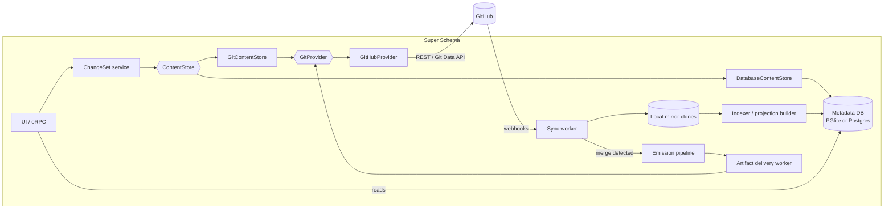

# GitOps storage mode — design

Status: implemented; tenant scope amended 2026-11-12 · Date: 2026-11-02

Tenant storage and onboarding supersede the original deployment-wide exclusivity: [tenant storage implementation](../plans/2026-11-12-tenant-storage-onboarding.md). Each tenant chooses database or Git through Settings. Database row guards and sync gating enforce that choice; the deployment-wide environment flag initializes legacy null choices once.

Implemented behavior and activation: [GitOps storage guide](../../gitops-storage.md), [verification record](../../testing/gitops-storage-verification.md). The implementation reads immutable Git objects through the provider API instead of maintaining disk clones. Product settings additionally define the default same-repository environment lifecycle; the root can be the whole repository or one folder.

## 1. Intent

Super Schema stores all schema content in Postgres/PGlite today. Some organizations want **Git as the system of record (SoR)** for
schema contracts — the way Apicurio Registry's `gitops` storage and xRegistry's file layouts treat a repo as the registry — so that
every change is reviewed as a GitHub pull request, history and blame live in Git, and downstream repos consume generated artifacts
from Git.

Unlike Apicurio's GitOps mode (read-only registry; writes happen outside it), Super Schema stays the **authoring tool**: UI edits
become drafts, drafts become a PR, the PR review is the approval, the merge lands a snapshot, and a promotion PR releases it.

## 2. Goals, non-goals, anti-goals

**Goals**
- Two mutually exclusive content storage modes per tenant: `database` (today's storage; adopts the new versioning model) and `git`.
- In `git` mode: every create/update/deprecate/delete becomes a draft; drafts are grouped into a **change set scoped to one product**;
  submitting opens a GitHub PR **authored by the user**; GitHub PR review + merge is the only approval path.
- UI shows change-set / PR state (draft, in review, changes requested, conflicts, checks, merged, closed) and version stage
  (snapshot, promotion in review, released).
- Adopt the snapshot → promote versioning model (§7) in **both** modes.
- On every snapshot merge and every promotion merge, generate implementation artifacts and open PRs in **per-product target repos**.
- Git provider is pluggable: GitHub.com first, GitLab later (GHES should mostly work via base URL).

**Non-goals (this version)**
- In-app approvals in git mode (may come later from user feedback). Database mode keeps today's governance.
- GitLab / Bitbucket adapters (interface only).
- Registry publication, infrastructure provisioning, deployment — promotion does not deploy.
- Mixing storage ownership within one tenant. Different tenants may use different backends.
- Git → database migration. Not in the UI; a separate offline utility may be built later if needed. Database → git ("Export to Git") is the only supported direction.

**Anti-goals (failure even if it "works")**
- Postgres silently remaining a second source of truth for schema content in git mode.
- PRs authored by a bot so the real author can approve their own change.
- UI page loads that call GitHub synchronously.
- A released version's files changing after release.

## 3. Constraints (from the codebase)

- Next.js 16 + oRPC + Prisma 7; `DB_PROVIDER` = `pglite` | `postgresql` (`src/lib/db-provider.ts`, `docs/database.md`).
- Auth.js v5 with `Account` table and admin-configured providers (`src/lib/auth.ts`, `src/lib/auth/providers.ts`).
- Existing Epic 10 scaffolding is **stubbed** (no real git/GitHub calls): `GitConfig` (single global), `GitPullRequest`,
  `src/services/git.service.ts` (`planGitExport`, path builders), `src/services/git-pr.service.ts` (`buildPrBody`, `shouldCreatePr`,
  `syncPrStatus` stub). Reuse the pure helpers; replace the stubs.
- Versioning today: `MAJOR.MINOR`, no patch (`src/lib/entity-versioning/version-math.ts`); immutable `EntityVersion` /
  `EventSpecVersion` rows guarded by a DB trigger; draft = live row + `hasUnpublishedChanges`.
- Entity `domainId`/`productId` are nullable in the schema, but objects are always created inside a product and inherit both —
  every object has exactly one owning product.
- `yaml` (eemeli) already a dependency.

## 4. Decisions made with the user

| Topic | Decision |
|---|---|
| SoR | Exactly one per deployment: database **or** git. In git mode the DB holds only Super Schema metadata. |
| Metadata DB | Whatever `DB_PROVIDER` says. PGlite is not tied to GitOps; Postgres needed for multi-replica. |
| Change-set scope | One product → one PR → that product's owners review. |
| Approvals | Git mode: GitHub PR review/merge only. DB mode: existing in-app governance. |
| Repos | Per-tenant binding (same or different repo, org, credentials). Per-product override + per-product target repos. |
| Identity | Users link GitHub; PRs/commits are truly theirs. |
| Provider | GitHub first, pluggable for GitLab. |
| Drafts | Hybrid: private drafts in metadata DB → user chooses Submit → branch + PR; later edits push to the same branch. |
| Overlap | Allowed; warn about conflicts. |
| File format | Structured YAML/JSON canonical document per object, versioned (the document Super Schema produces). |
| Versioning | Snapshot → promote model (event-schema-central `schema-versioning.md`), adapted in §7, in **both** modes, same milestone. |
| Mode switching | Database → git only (Export to Git, full released history). No git → database path in the UI; possible separate utility later. |
| Artifact delivery | On every snapshot merge (and promotion merge); Super Schema opens a PR in each target repo for that repo's owners. |
| Access | Assume GitHub App is installed on all involved repos for now. |

## 5. Architecture

### 5.1 Modes

```
Tenant.contentStorage = database | git  (per tenant)
CONTENT_STORAGE = database | git         (one-time legacy initialization default)
DB_PROVIDER     = pglite   | postgresql (metadata + projection store, independent)
```

In `git` mode the existing content tables (`Entity`, `Field`, `EntityVersion`, `EventSpec*`, `Trait`, `SharedEnum`, `CustomScalar`,
`UnionType`, `ServiceDefinition`/`Operation*`, `InterfaceDefinition`, ...) become a **read projection** rebuilt from Git. Existing
read queries keep working; only write paths change. The projection is disposable: a lost DB is rebuilt by re-indexing the repo.

### 5.2 Components



- **ContentStore** (new interface): `saveDraft`, `discardDraft`, `submit`, `promote`, `read*`. `DatabaseContentStore` wraps today's
  services; `GitContentStore` writes drafts to metadata tables and git via `GitProvider`.
- **GitProvider** (new interface): auth (installation + user tokens), `createBranch`, `commitFiles` (atomic multi-file),
  `openPullRequest`, `updatePullRequest`, `getPullRequest` (reviews, checks, mergeability), `verifyWebhook`, `parseWebhook`,
  `fetch/clone` URL. `GitHubProvider` implements it; `GitLabProvider` later.
- **Sync worker**: receives webhooks (`push`, `pull_request`, `pull_request_review`, `check_suite`/`check_run`, `installation`), plus
  a polling fallback (default every 5 min per binding) and a manual "Sync now". Fetches into the mirror and calls the Indexer.
- **Indexer**: diffs the mirror between last indexed SHA and new HEAD, parses changed canonical files, upserts the projection,
  records `indexedSha` per binding. Invalid files are recorded as **index errors** visible in the UI, never silently skipped.
- **Artifact delivery worker**: on a merge that changes a snapshot or release, runs the emission pipeline for the product's target
  bindings and opens/updates PRs in target repos.
- **Jobs**: a DB-backed job/outbox table polled in-process (works on PGlite and Postgres; multi-replica uses `FOR UPDATE SKIP LOCKED`
  on Postgres). Builder may substitute `pg-boss` on Postgres.

### 5.3 Libraries

| Need | Library | Why |
|---|---|---|
| GitHub App auth, installation + user tokens, token refresh | `@octokit/app`, `@octokit/auth-app`, `@octokit/oauth-app` | Official; handles JWT → installation token, user-to-server tokens, refresh |
| REST / GraphQL API | `@octokit/rest` (or `octokit` umbrella), `@octokit/graphql` | PRs, reviews, checks, Git Data API |
| Webhooks | `@octokit/webhooks` | Signature verification + typed events |
| Writes (commits) | GitHub **Git Data API** (blobs → tree → commit → ref) via Octokit | Atomic multi-file commit without a working copy; no clone contention; multi-replica safe. GitLab equivalent: Commits API with multiple `actions` |
| Reads (mirror) | `simple-git` (wraps `git` CLI) — fallback `isomorphic-git` if the image cannot ship `git` | Bare/partial mirror clone, fast `fetch` + `diff --name-only` for incremental indexing |
| YAML | `yaml` (already present) | Deterministic serialization, key ordering, comments preserved on read |
| Canonical doc validation | `ajv` (+ `ajv-formats`) against a published JSON Schema for the canonical doc | Same schema used by CI in the repo |
| 3-way object merge | custom field-keyed JSON merge (optionally `node-diff3` for text fields) | Line merges are wrong for structured docs |

**Why not clone-and-push for writes:** a working copy per user/change set is slow, needs disk per replica, and races. Git Data API
commits are atomic and stateless. The mirror is read-only and shared.

## 6. Repository layout (canonical schema repo)

Per tenant binding `{repo, branch (default main), basePath}`; several tenants may share a repo with different `basePath`s.

```
<basePath>/
  tenant.yaml                         # tenant metadata (name, slug)
  CODEOWNERS fragment → generated root CODEOWNERS entries (see below)
  domains/<domain-slug>/
    domain.yaml                       # name, description, owners
    products/<product-slug>/
      product.yaml                    # name, description, tier, owners (GitHub users/teams)
      entities/<entity-slug>/
        1.0.0/entity.yaml             # released, immutable
        1.1.0_snapshot/entity.yaml    # current snapshot, mutable
      events/<event-slug>/<version>/event.yaml
      traits/<trait-slug>/<version>/trait.yaml
      enums/<enum-slug>/<version>/enum.yaml
      scalars/ unions/ services/ interfaces/ ...  (same pattern)
```

- One canonical document per object per version: the structured YAML Super Schema produces (superset of today's
  `.superschema.json`: definition, fields with all decorator keys, metadata, references with pinned versions, provenance).
  Document carries `apiVersion: superschema.io/v1`, `kind`, `id` (stable cuid, survives renames), `version`, `stage`.
- Reviewers read this YAML diff in GitHub. Generated artifacts never live in the canonical repo.
- **CODEOWNERS** is generated from `product.yaml`/`domain.yaml` owners, written in the same change set that edits owners.
  Branch protection on `branch` requires code-owner review (repo admin config; Super Schema shows a warning if not detected).
- **CI**: Super Schema ships a reusable GitHub Action (`superschema validate`) that validates documents against the canonical JSON
  Schema, checks version rules (§7), forbids edits under released version folders, and checks reference integrity. Results show
  as PR checks and are mirrored in the UI.
- Hand edits made directly in GitHub are legitimate (Git is SoR): they go through the same PR + CI and appear after sync.

## 7. Versioning changes (both modes)

Adapted from `event-schema-central/docs/schema-versioning.md`.

1. **SemVer `MAJOR.MINOR.PATCH`.** Add `patch` to `EntityVersion`/`EventSpecVersion` (and other versioned objects). Extend
   `EntityVersionChangeKind` with `PATCH`. Bump classifier gains a PATCH tier (docs/example/description corrections that preserve
   validity). Raise-only rule (`resolveBump`) stays. Existing `M.m` versions migrate to `M.m.0`.
2. **Version stage `SNAPSHOT | RELEASED`.** Label `1.1.0_snapshot` vs `1.1.0`. Snapshot rows are mutable; the immutability trigger
   applies only to `RELEASED`. At most one open snapshot per object; its number must exceed the latest release; a released number is
   never reused as a snapshot.
3. **Snapshot ≠ release.** In git mode a merged change-set PR lands/updates the snapshot on `main`. In DB mode today's "Publish"
   becomes "Save snapshot" semantics (the snapshot row is updated in place).
4. **Promote** is a separate action. Git mode: a promotion PR renaming `x.y.z_snapshot/` → `x.y.z/`, rewriting version-derived
   identities (e.g. CloudEvents `dataschema`), stage → `RELEASED`. DB mode: Promote button, optionally gated by in-app governance.
5. **Next snapshot** after a release is chosen from the most severe change across the object. If a breaking change lands in a
   planned minor snapshot, the snapshot target is raised (rename folder) before promotion; CI fails until it is.
6. **References.** Released versions may only reference released versions. Snapshots may reference snapshots. Unversioned lookups
   prefer the highest release; for objects with no release, fall back to the newest snapshot (bootstrap only).
7. **Registry versions stay separate** (no 1:1 mapping).

## 8. Status model

Two layers shown together in the UI.

**Change set** (git mode only)

| State | Source |
|---|---|
| `DRAFT` | local, metadata DB, not submitted |
| `IN_REVIEW` | PR open, no blocking review |
| `CHANGES_REQUESTED` | latest review requests changes |
| `APPROVED` | required approvals present, not merged |
| `CONFLICT` / `OUT_OF_DATE` | PR not mergeable, or a drafted object's base blob SHA ≠ `main` |
| `CHECKS_FAILING` | required checks failing (flag, combinable with above) |
| `MERGED` | PR merged → objects show as snapshot |
| `CLOSED` | PR closed unmerged → drafts return to `DRAFT` (reopenable) or are discarded |

**Version stage** (both modes): `x.y.z_snapshot` → `PROMOTION_IN_REVIEW` (git) → `x.y.z` released. Object lifecycle
(`ACTIVE` → `DEPRECATED` → `RETIRED`) stays and travels through change sets as edits. `EntityStatus.DRAFT` (never released) is
derived: object has no released version.

## 9. User flows

### 9.1 Setup (admin)

1. Admin selects Git in tenant Storage settings and registers the shared GitHub App (app id, private key, webhook secret, client
   id/secret) in admin settings.
2. Per tenant: **Tenant settings → Git binding**: installation, repo, branch, basePath. "Test connection" really calls GitHub
   (replaces stub `testConnection`).
3. **Bootstrap**: empty repo → "Initialize" opens a PR creating `tenant.yaml` and the folder structure. Existing DB-mode content →
   "Export to Git" opens one PR per product with all objects (released versions as released folders, unreleased drafts as
   snapshots). Until merged the tenant is read-only.
4. Per product: **Product settings → Git & targets** (new page): canonical repo override (optional), target bindings
   `{target, repo, branch, pathTemplate}` e.g. Avro → `events-repo` `schemas/{domain}/{object}/{version}/`.

### 9.2 Author a change

```mermaid
sequenceDiagram
  actor U as Author
  participant SS as Super Schema
  participant DB as Metadata DB
  participant GH as GitHub
  actor O as Product owners
  U->>SS: Edit entity (product P)
  SS->>DB: Upsert draft in open change set (U, P); record base blob SHA
  SS-->>U: "Draft · 3 changes in P" + overlap warnings
  U->>SS: Submit (title, description)
  SS->>SS: Require linked GitHub; validate; compute bump & target snapshot
  SS->>GH: Create branch ss/<product>/<changeset-id> from main (user token)
  SS->>GH: Atomic commit of all drafted files (user token)
  SS->>GH: Open PR (user token), body = compat report, bumps, overlap links
  SS->>DB: ChangeSet IN_REVIEW, store PR number/URL
  GH-->>O: Review request via CODEOWNERS
  O->>GH: Review / request changes
  GH-->>SS: Webhook → update change set state
  U->>SS: More edits to same change set
  SS->>GH: New commit on same branch
  O->>GH: Approve + merge
  GH-->>SS: push + pull_request.closed(merged)
  SS->>SS: Fetch mirror, re-index, mark objects snapshot, clear drafts
  SS->>SS: Enqueue artifact delivery
```

Rules:
- One open change set per (user, product). Edits in another product start another change set.
- Drafts are private to their author until Submit. After Submit the change set is visible to everyone with read access to the product.
- No linked GitHub → can browse and draft; Submit disabled with "Connect GitHub".
- "Discard change set" deletes drafts (and closes the PR + deletes the branch if submitted).

### 9.3 Overlap and conflicts

- While drafting X, if X is in another open change set/PR, show "X is also in PR #142 by Bob (in review)" in the editor and in the
  change set. Submitting is allowed.
- When sync sees `main` changed a file the draft is based on, the drafted object becomes **Out of date**. "Refresh" runs an
  object-level 3-way merge (base / new main / draft), field-keyed by stable field id: non-overlapping → auto-merge (and push if
  submitted); overlapping → field-level resolver UI. GitHub's mergeability flag is mirrored as fallback.

### 9.4 Promote

From an object (or a product-level "Release" view listing snapshots): Promote → validation (no snapshot references from the
release, CI rules) → promotion PR (rename folder, rewrite identities) authored by the user → owners review → merge → indexer marks
`RELEASED` → artifact delivery for the release.

### 9.5 Artifact delivery

On merge affecting snapshot or release versions of product P:
1. Emission pipeline renders each target bound in P's settings for the changed objects/versions.
2. For each target repo: Super Schema (GitHub App installation token — no human author; the source PR and its author are linked in
   the body) maintains **one rolling PR per (product, target repo)** on branch `superschema/<product>`. A new snapshot merge before
   the previous delivery PR merged updates that PR instead of opening another. Releases get their own PR (not rolled into snapshot
   PRs) so a release is reviewable on its own.
3. Each artifact embeds provenance: source object id, version label, canonical commit SHA.
4. Per (object, target) status: `PENDING`, `PR_OPEN`, `DELIVERED` (PR merged), `FAILED` (retry button) — extends
   `EmissionTargetStatus`.

### 9.6 Reading

All pages read the projection. Header shows binding freshness ("Synced 40 s ago · main@abc123", or a stale/error banner).
History view = released + snapshot versions from the projection, with links to commits/PRs.

## 10. Data model changes (metadata DB)

- `GitProviderApp` (deployment): provider, app id, encrypted private key, webhook secret, client id/secret, base URL.
- `TenantGitBinding` (replaces global `GitConfig`): tenantId, provider, installationId, repo owner/name, branch, basePath,
  `indexedSha`, `lastSyncAt`, `lastSyncStatus`, `lastError`.
- `ProductGitSettings`: productId, optional canonical repo override, `targets: ProductTargetBinding[]`
  `{target, repoOwner, repoName, branch, pathTemplate, enabled}`.
- `ChangeSet`: id, tenantId, productId, authorId, kind (`EDIT` | `PROMOTION` | `BOOTSTRAP`), state (§8), title, description,
  branch, prNumber, prUrl, headSha, review summary JSON, checks summary JSON, mergeable, timestamps.
- `ChangeSetItem`: changeSetId, objectKind, objectId (stable id), operation (`CREATE`|`UPDATE`|`DELETE`|`RENAME`), path,
  `baseBlobSha`, draft document JSON, outOfDate flag.
- `GitPullRequest` folds into `ChangeSet` (+ `DeliveryPullRequest` for target repos: product, target repo, branch, prNumber,
  state, versions included).
- GitHub user link: `Account` row (provider `github`, encrypted access/refresh tokens, expiry) — added via a **Connect GitHub**
  flow separate from login; GitHub as a login provider remains optional.
- `IndexError`: binding, path, sha, message.
- Versioning: `patch`, `stage` on version tables; `PATCH` change kind; trigger scoped to `RELEASED`.
- `Job` table for sync / index / delivery work.

## 11. Security

- GitHub App private key, webhook secret, user tokens encrypted at rest (same mechanism as other secrets in the app).
- Webhooks verified by signature; delivery id de-duplicated.
- User actions use user tokens only; installation token used for mirror fetch, status sync, and delivery PRs.
- Tenant isolation: a binding's mirror and projection rows are tenant-scoped; webhooks routed by installation + repo + basePath.

## 12. Calls made by the designer (not yet confirmed by the user)

- **Who may submit:** a Super Schema user with edit rights on the product (existing access control) **and** a linked GitHub account.
  GitHub enforces its own write/review permissions; `product.yaml` owners are GitHub users/teams and are not mapped to Super Schema users.
- **Single-owner products:** GitHub ignores an author's own approval. Super Schema warns in Product settings when a product has fewer
  than two owners; no extra enforcement beyond GitHub.
- **References at Submit:** validated against `main` plus the change set's own drafts. Referencing an object that exists only in
  another unmerged change set is blocked ("merge PR #n first"). Cross-product references within the same canonical repo are checked by
  CI; cross-repo/cross-tenant references are checked only by Super Schema at Submit.
- **CODEOWNERS:** GitHub reads a single file. Change sets edit only `product.yaml`/`domain.yaml` owners; after such a merge Super Schema
  (installation token) opens/updates one rolling "owners sync" PR regenerating `.github/CODEOWNERS` for the whole repo. Change sets never
  touch CODEOWNERS, so no conflicts between them.
- **Delivery PRs:** target repo owners review and merge; never auto-merged. The rolling branch `superschema/<product>` is owned by Super
  Schema: the next delivery force-updates it, and if it detects human commits on it, it posts a PR comment that they were overwritten.
- **Slugs:** mutable. Folder names use slugs, identity uses the document `id`. A rename is a `RENAME` change-set item that moves the whole
  object folder (all versions, contents unchanged); CI allows renames of released folders when content is byte-identical. The indexer
  matches by `id`, so hand-moves in GitHub are tolerated.
- **Export to Git:** carries full released history (every released version as its own folder, ids preserved) plus unreleased state as a
  snapshot.

## 13. Left to the builder

- Exact canonical YAML schema (start from `buildExportEntityDefinition` + version/field snapshots; must round-trip losslessly).
- Mirror strategy details (bare vs partial clone, location, per-replica vs shared volume).
- Polling interval, job retry/backoff, rate-limit handling (conditional requests / ETags).
- Field-level resolver UI design.
- Phasing (suggested: versioning model in both modes → provider + identity → change sets/PR → sync/index → promotion → artifact delivery).
